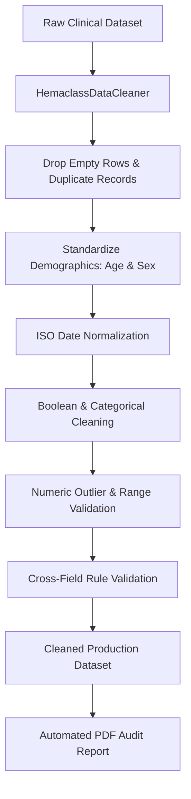

# 🩸 Hemaclass Clinical Data Cleaning & Preprocessing Suite

[](https://streamlit.io/)
[](https://www.python.org/)
[](https://opensource.org/licenses/MIT)
[](https://github.com/KABURAKURIA/hema-class-data-cleaning)

An automated, clinical-grade data cleaning engine and interactive Streamlit web application specifically designed for preprocessing, standardizing, and validating hematological classification datasets.

---

## 🏥 Problem Statement & Overview

Clinical hematology datasets frequently suffer from non-standardized categorical entries, ambiguous boolean flags, inconsistent date formatting, irregular age/sex encodings, and clinical cross-field inconsistencies. This suite provides:

1. **Automated Data Cleaning Pipeline (`HemaclassDataCleaner`)**:
   - Identifies and drops null-only records and redundant duplicate observations.
   - Cleans and normalizes string encodings (removes trailing whitespace, standardized casing).
   - Standardizes demographic columns (Age normalization, biological Sex normalization).
   - ISO-8601 clinical date parsing and temporal validity checking.
   - Robust boolean flag mapping (`Yes/No`, `Y/N`, `1/0`, `True/False`).
   - Cross-field clinical constraint validation.
2. **Interactive Streamlit Web Dashboard**:
   - Drag-and-drop CSV/Excel file upload.
   - Before-and-after distribution comparisons.
   - Real-time cleaning log and data quality score.
3. **Automated Audit PDF Report Generation (`generate_pdf.py`)**:
   - Produces executive clinical data quality reports detailing all remediation actions taken.

---

## 🛠️ Pipeline Architecture



---

## 💻 Installation & Quickstart

```bash
# Clone the repository
git clone https://github.com/KABURAKURIA/hema-class-data-cleaning.git
cd hema-class-data-cleaning

# Install dependencies
pip install -r requirements.txt

# Run the interactive Streamlit application
streamlit run app.py
```

---

## 📋 Technology Stack

- **Framework**: Streamlit
- **Core Analytics**: Python, Pandas, NumPy
- **Document Reporting**: ReportLab / Report Engine
- **Validation**: Regex, Statistical rule-based verification

---

## 📄 License

MIT License. See [LICENSE](LICENSE) for details.
